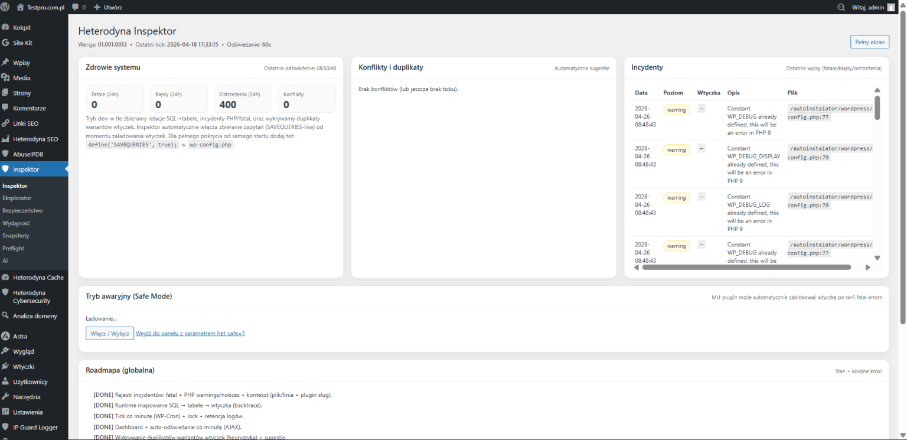

# Heterodyna Inspektor

### Zaawansowane narzędzie diagnostyczne dla WordPress

[**Pobierz wtyczkę**](http://testpro.com.pl/wp-content/uploads/2026/04/heterodyna-inspektor.zip)

**Heterodyna Inspektor** to wtyczka do analizy i monitorowania strony WordPress w czasie rzeczywistym. Powstała z myślą o administratorach, developerach oraz osobach zajmujących się SEO i bezpieczeństwem.

---

## 🔍 Co robi ta wtyczka?

Heterodyna Inspektor zbiera w jednym miejscu informacje potrzebne przy diagnozowaniu WordPressa. Pozwala sprawdzić stan strony i serwera, wychwytywać błędy i problemy wydajnościowe, obserwować zapytania oraz łatwiej znaleźć problemy związane z wtyczkami, motywem lub konfiguracją środowiska.

To po prostu **centrum diagnostyczne strony**, do którego można zajrzeć zamiast szukać informacji w kilku różnych miejscach.

---

## ⚙️ Główne możliwości

### 🧠 Diagnostyka systemu

Możesz sprawdzić stan WordPressa i PHP, podstawowe informacje o środowisku oraz aktywne wtyczki.

### 📊 Monitoring

Inspektor zbiera dane przydatne przy analizie wydajności i działania strony, w tym informacje o zapytaniach oraz zdarzeniach rejestrowanych przez wtyczkę.

### 🧩 Analiza wtyczek i zależności

Wtyczka pomaga wykrywać konflikty i błędy oraz mapować zależności związane z wtyczkami, tabelami, endpointami i hookami.

### 🛡️ Bezpieczeństwo i incydenty

Panel pozwala przeglądać zarejestrowane ostrzeżenia, błędy i incydenty, dzięki czemu łatwiej zauważyć niepokojące zachowanie lub problem po aktualizacji.

### 🌐 Analiza HTTP i środowiska

Inspektor zawiera narzędzia pomocne przy sprawdzaniu działania strony, jej odpowiedzi oraz konfiguracji środowiska WordPress.

---

## ⚡ Po co to wszystko?

Przy większej liczbie wtyczek znalezienie źródła problemu potrafi zająć sporo czasu. Heterodyna Inspektor ma skrócić tę drogę: pokazać w jednym panelu, co dzieje się ze stroną i gdzie warto zacząć szukać przyczyny błędu albo spadku wydajności.

Sprawdza się przy codziennej administracji, testach po aktualizacjach, wdrożeniach oraz diagnozowaniu problemów, które trudno odtworzyć na pierwszy rzut oka.

---

## 🎯 Dla kogo?

Wtyczka jest przeznaczona dla administratorów WordPress, developerów, specjalistów SEO oraz właścicieli stron i sklepów, którzy chcą mieć lepszy wgląd w działanie swojej instalacji.

---

## 🔧 Zastosowanie

Heterodyna Inspektor może być używany do debugowania problemów na stronie, analizy błędów PHP i WordPressa, kontroli działania wtyczek, sprawdzania zmian po aktualizacjach oraz szukania przyczyn problemów z wydajnością.

---

## 💡 Integracja

Wtyczka może działać obok innych rozwiązań Heterodyna związanych z SEO, cache, bezpieczeństwem i analizą domen, tworząc wspólny zestaw narzędzi do zarządzania stroną.

---

## Wymagania

W kodzie wtyczki zadeklarowano:

- WordPress 6.0 lub nowszy,
- PHP 7.4 lub nowszy.

## Struktura projektu

Główny plik wtyczki:

`heterodyna-inspektor/heterodyna-inspektor.php`

Kod źródłowy wtyczki znajduje się w katalogu `heterodyna-inspektor/`, a zrzut ekranu używany w README w katalogu `screenshots/`.

## Autor

**Heterodyna Team Software**  
https://heterodynateamsoftware.pl
